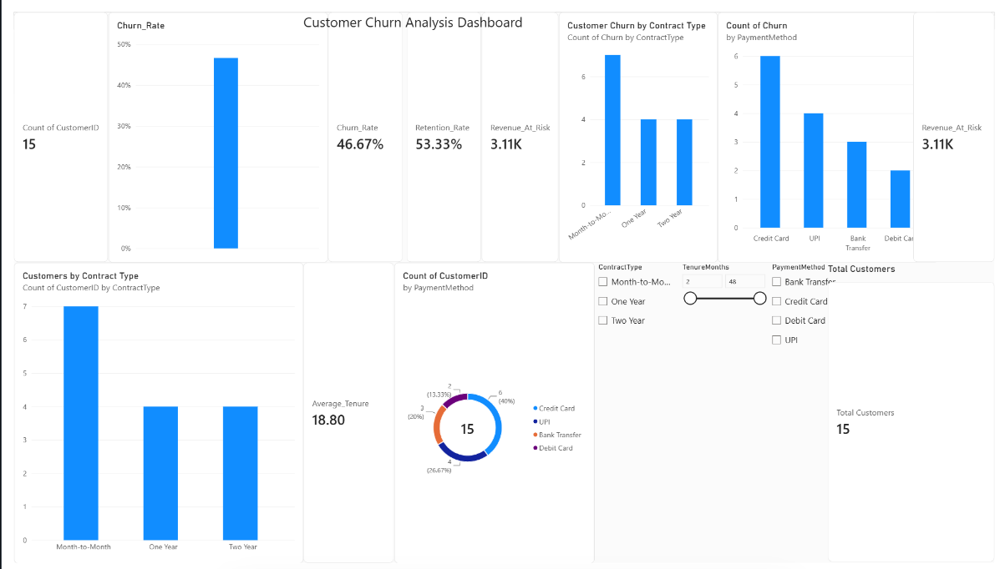

# Customer Churn Analysis | Excel, CSV & Power BI

A beginner-friendly Data Analytics portfolio project focused on customer churn, data quality validation, exploratory analysis, and dashboard reporting using Microsoft Excel, CSV, and Power BI.

## Project Overview

Customer churn occurs when customers stop using a company's products or services. Understanding churn patterns can help businesses investigate customer retention and identify areas for further analysis.

In this project, I explored a small customer dataset, validated data quality, calculated basic churn and retention metrics, examined contract-level churn patterns, and reviewed the results through a Power BI dashboard.

**Dashboard Preview**

*The dashboard image will appear here after `dashboard-preview.png` is uploaded to the repository.*

**Note:** This is a small illustrative dataset. The findings should not be generalized to a real customer population.

## Objectives

- Review the structure of the customer dataset.
- Calculate churn and retention rates.
- Check for missing values and duplicate customer IDs.
- Validate the relationship between monthly charges, tenure, and total charges.
- Explore churn patterns across contract types.
- Present key metrics through a Power BI dashboard.
- Document findings and limitations clearly.

## Tools & Technologies

- **Microsoft Power BI Desktop** — dashboard reporting
- **Microsoft Excel** — data review and summary analysis
- **CSV** — structured data handling
- **Data quality validation** — missing-value, duplicate-ID, and consistency checks
- **Exploratory Data Analysis (EDA)** — descriptive metrics and comparisons

## Project Files

| File | Description |
|---|---|
| `customer_churn_raw_dataset.csv` | Source dataset supplied for the project |
| `Customer_Churn_Analysis_Workbook.xlsx` | Workbook containing raw data, summaries, contract analysis, and definitions |
| `Customer_Churn_Data_Quality_Report.pdf` | Data quality checks and exploratory findings |
| `Customer_Churn_Dashboard.pdf` | Static PDF preview of the Power BI dashboard |
| `Customer_Churn_Analysis.pbix` | Power BI Desktop project file |
| `dashboard-preview.png` | Dashboard preview image |
| `README.md` | Project documentation |

## Dataset Overview

- **Total customer records:** 15
- **Number of fields:** 11
- **Missing cells:** 0
- **Duplicate CustomerIDs:** 0

The supplied dataset includes customer attributes such as age, tenure, contract type, monthly charges, total charges, support tickets, and churn status.

## Key Results

| Metric | Result |
|---|---:|
| Customers in sample | 15 |
| Average age | 39.07 years |
| Average tenure | 18.80 months |
| Churned customers | 7 |
| Retained customers | 8 |
| Churn rate | 46.67% |
| Retention rate | 53.33% |
| TotalCharges for churned records | 3,109.51 |
| MonthlyCharges for churned records | 409.93 |

*Currency and charge units were not specified in the source dataset. The 3,109.51 TotalCharges sum corresponds to the dashboard's approximately 3.11K KPI.*

## Data Quality Checks

- No missing values were found in the supplied dataset.
- No duplicate `CustomerID` values were found.
- `TotalCharges` matched `MonthlyCharges × TenureMonths` for all records within floating-point precision.
- Observed age range: 23–60 years.
- Observed tenure range: 2–48 months.
- Observed support ticket range: 0–6.

These observed ranges are descriptive and do not, by themselves, establish the presence or absence of statistical outliers.

## Exploratory Findings

### Contract Type and Churn

In this sample, all 7 churned customers had a Month-to-Month contract. No churn was recorded among customers with One Year or Two Year contracts.

This pattern may be worth investigating using a larger dataset. However, the sample is too small to establish causation or provide a reliable estimate of real-world churn.

### Charges Associated with Churned Records

The sum of `TotalCharges` for churned records was **3,109.51**, matching the dashboard's approximately **3.11K** KPI.

The sum of `MonthlyCharges` for churned records was **409.93**.

These are descriptive sums, not forecasts of revenue loss or customer lifetime value.

## Analysis Workflow

1. Reviewed the supplied customer dataset.
2. Checked the dataset structure and field count.
3. Checked missing values and duplicate customer IDs.
4. Validated the relationship between monthly charges, tenure, and total charges.
5. Calculated churn and retention metrics.
6. Compared churn outcomes across contract types.
7. Reviewed the Power BI dashboard and documented findings.
8. Recorded limitations to avoid overinterpreting the results.

## Limitations

- The dataset contains only 15 customer records, so the findings are illustrative and not statistically representative.
- The original external source and sampling method were not provided.
- Currency and charge units were not specified.
- The observed contract-level pattern does not establish causation.
- The supplied `.pbix` file should be opened in Power BI Desktop to verify its visuals, filters, measures, and refresh behavior.
- Before publishing publicly, confirm that the dataset is permitted for sharing and contains no confidential customer information.

## How to Use This Project

1. Open `Customer_Churn_Analysis_Workbook.xlsx` to review the data and summaries.
2. Open `Customer_Churn_Analysis.pbix` in Microsoft Power BI Desktop to inspect the report.
3. Open `Customer_Churn_Dashboard.pdf` for a static dashboard preview.
4. Read `Customer_Churn_Data_Quality_Report.pdf` for the validation checks and exploratory findings.

## Skills Demonstrated

- Data quality validation
- Descriptive data analysis
- Churn and retention metric calculation
- Contract-level comparisons
- Excel and CSV data handling
- Power BI dashboard reporting
- Analytical documentation
- Communicating data limitations responsibly

## Project Status

**Initial portfolio version completed.**

Future improvements may include verifying Power BI measures and expanding the analysis using a larger dataset.

---

Created as a learning and portfolio project in Data Analytics.
